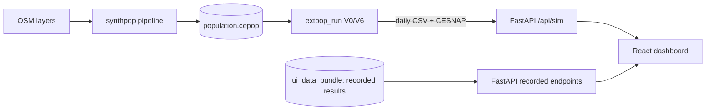

# CityEpi-GPU

A parallel agent-based epidemic simulator on **synthetic agents placed on real Bengaluru Urban OpenStreetMap geography**, implemented
as seven execution backends (V0–V6: sequential, ILP, OpenMP, SIMD/NEON, OpenACC, naive CUDA, optimised CUDA) and wrapped in an
interactive dashboard with live simulation, per-agent replay on a map, and a performance lab.

> **Read this first.** The population is **synthetic**: agents are not residents of Bengaluru, "occupied candidate homes" are OSM
> buildings that received synthetic agents (not verified households), destinations and capacities are model assumptions, and the
> household-size distribution and transmission rates are experimental. Results are **not** a calibrated forecast for Bengaluru.
> See [`docs/limitations.md`](docs/limitations.md).

## Contents
[Motivation](#motivation) · [Problem](#problem-statement) · [Objectives](#objectives) · [Architecture](#architecture) · [Backends](#backends-v0v6) ·
[PAGP concepts](#pagp-concepts) · [Data and population](#data-and-population-methodology) · [Results](#results-summary) · [Install](#installation) ·
[Run](#running) · [Kaggle CUDA](#kaggle-cuda-workflow) · [Studio and Viewer](#simulation-studio-and-viewer) · [Testing](#testing) ·
[Limitations](#scientific-limitations) · [Repository layout](#repository-structure) · [Docs index](#documentation-index)

## Motivation
City-scale epidemic simulation needs millions of agent updates per simulated day and many repetitions (seeds, scenarios). The update has
the same structure every day — per-location infection pressure, per-agent random draws, state transitions, reductions — which makes it a
good vehicle for studying parallel architectures and GPU programming, while geographic structure (homes, destinations, distances) makes
the results explorable on a map.

## Problem statement
Simulate S → E → I → R dynamics for an agent population where each agent has a home and a destination location, so that **every
backend produces bit-identical daily S/E/I/R counts** while executing in very different ways (scalar, multithreaded, SIMD, directive-based
GPU, hand-written CUDA), and measure honestly what each technique buys.

## Objectives
1. A deterministic epidemic model whose result does not depend on thread/warp scheduling (counter-based RNG, staged day, integer reductions).
2. Seven backends with recorded correctness (vs the V0 reference) and performance evidence.
3. A reproducible synthetic Bengaluru population pipeline from OSM layers to a binary input (CEPOP).
4. A dashboard that separates **recorded results** from **live runs**, and states the provenance and caveats of every number.
5. Tests and documentation sufficient to reproduce and defend each claim.

## Architecture

Details, sequence diagrams, data flow, CEPOP and CESNAP summaries: [`docs/architecture.md`](docs/architecture.md).

## Backends (V0–V6)

| | Technique | Source | What changes vs the previous step |
|---|---|---|---|
| **V0** | Sequential reference | `src/common/` | Defines the model and the results every other backend must reproduce exactly |
| **V1** | Instruction-level parallelism | `src/v1_ilp/` | Fused pass, inlined RNG with shared stages, branchless transitions, per-location probability table |
| **V2** | OpenMP | `src/v2_openmp/` | Parallel agent loop; per-thread histograms (or atomics) and reductions; selectable schedule |
| **V3** | SIMD (ARM NEON) / hybrid | `src/v3_simd/` | NEON RNG+transition (aarch64 only), and a hybrid with scalar RNG + NEON transition |
| **V4** | OpenACC | `src/v4_openacc/` | Directive-based GPU offload (NVHPC `-acc=gpu`) with explicit data regions |
| **V5** | Naive CUDA | `src/v5_cuda/` | Two kernels/day, global atomics, per-day host readback |
| **V6** | Optimised CUDA | `src/v6_cuda/` | Independent switches: warp/block count aggregation, async readback, CUDA Graphs, `exp`/RNG/load elision, block size |

**V7 (multi-scenario GPU) and V8 (MPI) are future ideas, not implemented.** The live Studio offers V0 everywhere and V6 only where a CUDA
device is probed; snapshots are V0-only.

## PAGP concepts
Instruction-level parallelism, thread-level parallelism, OpenMP scheduling, SIMD, SIMT/GPU execution, OpenACC, CUDA memory management,
hierarchical reductions, warp-level primitives (`__ballot_sync` + `__popc`), asynchronous execution, CUDA Graphs, deterministic parallel
execution, performance measurement, strong scaling/efficiency, correctness validation — each mapped to source files, evidence and
non-claims in [`docs/pagp_concepts.md`](docs/pagp_concepts.md). The dashboard's **PAGP Performance Lab** presents the same material interactively.

## Data and population methodology
* **Real:** processed OSM layers for Bengaluru Urban — buildings, roads, healthcare, amenities, leisure, land use — and the boundary.
* **Synthetic:** candidate homes (Tier A/B/C from OSM building/landuse tags), destinations with placeholder capacities, proximity
  de-duplication, an experimental household-size PMF, and a distance-kernel assignment with capacity caps.
* **Recorded datasets:** *legacy* (no explicit households) and *household-enabled* populations, 100,000 agents; the household dataset has
  206,478 candidate homes, 32,363 destinations, 238,841 locations (`kaggle_run_record.json`).
* **Input format:** CEPOP v1 ([`docs/cepop_format.md`](docs/cepop_format.md)); generator and assumptions: [`docs/synthetic_population.md`](docs/synthetic_population.md).

## Results summary
All numbers are recorded artifacts unless marked *live*. Full methodology and caveats: [`docs/methodology.md`](docs/methodology.md).

**Performance (kernel time, speedup vs the V0 of the *same* run):**
* V1: 2.21–2.38× vs V0 on Apple M1 (10k–500k agents), outputs identical.
* V2: best 100k point 5.49× vs V0 (static, 4 threads, efficiency 0.78); thread-local reductions 3–10× faster than atomics; scaling saturates near
  4 threads on the M1 (4P+4E cores).
* V3: full NEON ≈ 1.3× vs V0 but ≈ 1.7–1.8× **slower than V1**; hybrid 1.10–1.14× vs V1 at 10k–100k. SIMD is not a win here.
* V4 (Kaggle T4): 0.92× / 7.0× / 34.2× / 66.4× at 10k / 100k / 1M / 5M.
* V5 (Kaggle T4): 7.5× / 28.8× / 26.0× / 48.0×. V6 best recorded combination: 33.7× / 180× / 294× / 180× (kernel-only; end-to-end is lower).
* V6 correctness: `4212 V6 comparisons on Tesla T4; V6 OK`; `identical_v0` and `identical_v5` = yes on every recorded row.

**Epidemic (V0 / V6, 100,000 synthetic agents, 100 days, seed 42, 100 initially infected):**

| Scenario | Final S / E / I / R | Attack rate | Peak infectious | Peak daily incidence |
|---|---|---|---|---|
| Household-enabled | 65,371 / 1,257 / 2,343 / 31,029 | 34.629% | 2,891 (day 78) | 598 (day 66) |
| Legacy | 99,198 / 2 / 8 / 792 | 0.802% | 122 (day 4) | 29 (day 2) |

Transmission sensitivity attack rates: 0.755% (low) / 34.629% (baseline) / 71.089% (high) — the β values behind the labels are **not recorded**.
Ten seeds (42–51), V0 CPU only, household population only. The legacy/household gap is **not** a pure household-effect test (assignments also differ).
A live V0 run on the Mac reproduces the household baseline exactly (daily checksum `b213860e1d97b2c8`, same as Kaggle V0 and V6).

**Known caveats (kept visible in the Performance Lab):** Kaggle V3 rows are scalar-fallback (x86) measurements, not NEON; the OpenACC Kaggle run was
built with OpenMP off (its `V2_maxT` is not multithreaded); V6 at 1M agents has an **unexplained** anomaly (`V6_base` ≈ 35% slower than every
non-aggregating variant); profile CSVs are aggregated over the 100-day loop; V4 and V5/V6 come from separate sessions.

## Installation
Prerequisites: CMake ≥ 3.20, a C++17 compiler, Python 3 (tested with 3.12), Node (tested with 22.12). macOS Apple Silicon is the reference dev machine.

```bash
# 1. C++ simulator and the extpop_run executable used by the API (CPU build; works on a Mac)
cmake -S . -B build-sim -DCMAKE_BUILD_TYPE=Release && cmake --build build-sim -j

# 2. Backend
python3 -m venv backend/.venv && backend/.venv/bin/pip install -r backend/requirements.txt

# 3. Frontend
cd frontend && npm install && npm run e2e:install       # last step only needed for browser tests
```
Data: the dashboard reads `ui_data_bundle/` (override with `CITYEPI_DATA_DIR`). Do not regenerate or edit it; it holds recorded results.

## Running
```bash
# terminal 1 — API (http://127.0.0.1:8000, docs at /docs)
cd backend && .venv/bin/uvicorn app.main:app --port 8000
# terminal 2 — dashboard (http://localhost:5173)
cd frontend && npm run dev
```
**Restart the API after pulling backend changes**; the Studio shows a notice if it detects an older backend. Useful env vars:
`CITYEPI_RUNS_DIR` (where live runs are stored, default `backend/.runs`), `CITYEPI_EXTPOP_RUN` (path to `extpop_run`),
`CITYEPI_SIM_MAX_CONCURRENT` (default 2), `CITYEPI_API` (Vite proxy target).

## Kaggle CUDA workflow
CUDA cannot run on the M1 Mac; the GPU pages show **recorded** Kaggle T4 data. To re-validate or extend: build with
`-DENABLE_CUDA=ON -DENABLE_CUDA_V6=ON -DCMAKE_CUDA_ARCHITECTURES=75`, run `test_v6 --require-gpu`, `bench_v6 …`, `bench/analyze_v6.py`, writing
to a *new* results folder. Step-by-step notebook cells: [`docs/kaggle_cuda_workflow.md`](docs/kaggle_cuda_workflow.md). Backend docs:
[`docs/v4_openacc.md`](docs/v4_openacc.md), [`docs/v5_cuda.md`](docs/v5_cuda.md), [`docs/v6_cuda.md`](docs/v6_cuda.md).

## Simulation Studio and Viewer
**Studio** (`#studio`): choose a population, backend (V0; V6 is shown *unavailable* without a GPU), days, seed, initial infected, β's,
incubation/infectious days, optionally **Record per-agent snapshots**. The form validates locally and again on the server; progress is the
executable's own per-day output (never estimated); runs can be cancelled, deleted and exported (CSV, JSON). Runs execute `extpop_run` on
**this machine**; results are labelled live and kept apart from recorded ones. API: [`docs/simulation_api.md`](docs/simulation_api.md).

**Viewer** (**Open viewer** on a completed snapshot run): replays every agent's real state for every day on the Bengaluru map — play/pause,
1×/2×/4×/0.5× speed, step (←/→), slider seek, reset, replay; S/E/I/R counters and attack rate for the shown day, cross-checked against the daily
CSV; composition and active-infection views; trajectory chart with a day marker. **Agents are drawn at fixed home locations; nothing moves, and a
state change does not show where transmission happened.** Format: [`docs/snapshot_format.md`](docs/snapshot_format.md).

## Testing
```bash
ctest --test-dir build-sim --output-on-failure                       # C++ (7 tests)
backend/.venv/bin/python -m pytest tests/backend -q                   # backend API
.venv/bin/python -m pytest tests/python -q                            # CEPOP/generator (needs pyarrow, scipy, geopandas)
cd frontend && npm run typecheck && npm run test:unit && npm run e2e  # TS, unit, Playwright (starts its own servers)
```
Actual results, what each suite covers, the defects found, and measurements: [`docs/testing.md`](docs/testing.md); release checklist:
[`docs/release_checklist.md`](docs/release_checklist.md).

## Scientific limitations
Synthetic population and destinations; experimental household PMF and transmission rates; no mobility, ages, interventions or calibration;
fixed home locations in the viewer; ten seeds measure stochastic variability only; legacy-vs-household is not a clean causal test; no GPU
result was produced on the development Mac; V7/V8 not implemented. Complete list: [`docs/limitations.md`](docs/limitations.md).

## Repository structure
```
include/ src/            C++ model and backends (common, v1_ilp, v2_openmp, v3_simd, v4_openacc, v5_cuda, v6_cuda)
tools/                   extpop_run (CEPOP in, daily CSV + CESNAP out), snapshot writer
tests/                   C++ tests; python/ (generator); backend/ (API); fixtures/
bench/                   benchmark programs, analysis script, V1–V4 notes, reports; results/ (recorded, do not modify)
scripts/                 OSM audit and synthetic-population pipeline (synthpop/)
config/                  default population-generation config
backend/app/             FastAPI: recorded endpoints (main.py, geo.py, …) and sim/ (run manager, snapshots)
frontend/                React + TypeScript + Vite + Tailwind; src/, tests/ (unit), e2e/ (Playwright)
ui_data_bundle/          recorded datasets and results served by the dashboard (read-only)
docs/                    documentation (below)
```

## Documentation index
[`architecture`](docs/architecture.md) · [`pagp_concepts`](docs/pagp_concepts.md) · [`methodology`](docs/methodology.md) ·
[`limitations`](docs/limitations.md) · [`testing`](docs/testing.md) · [`release_checklist`](docs/release_checklist.md) ·
[`demo_guide`](docs/demo_guide.md) · [`kaggle_cuda_workflow`](docs/kaggle_cuda_workflow.md) · [`cepop_format`](docs/cepop_format.md) ·
[`snapshot_format`](docs/snapshot_format.md) · [`synthetic_population`](docs/synthetic_population.md) · [`simulation_api`](docs/simulation_api.md) ·
[`dashboard_pages`](docs/dashboard_pages.md) · [`v4_openacc`](docs/v4_openacc.md) · [`v5_cuda`](docs/v5_cuda.md) · [`v6_cuda`](docs/v6_cuda.md) ·
[`bench/README.md`](bench/README.md) (V1–V4 notes).

`README.txt` at the repository root is the data bundle's own readme and is kept as is.
