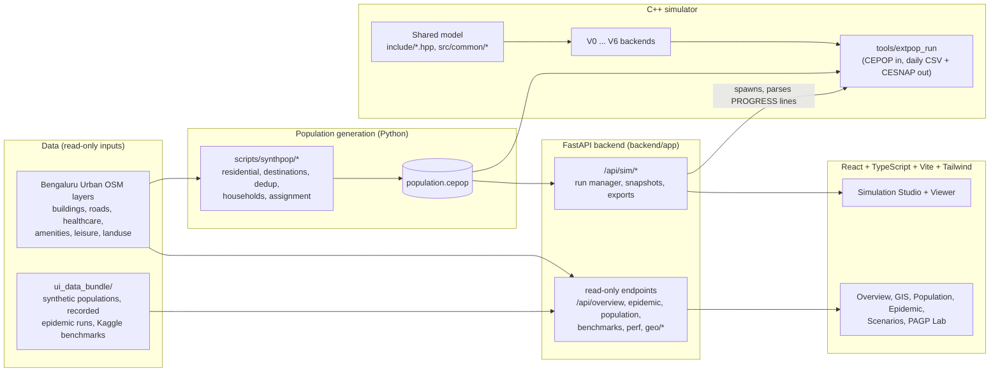
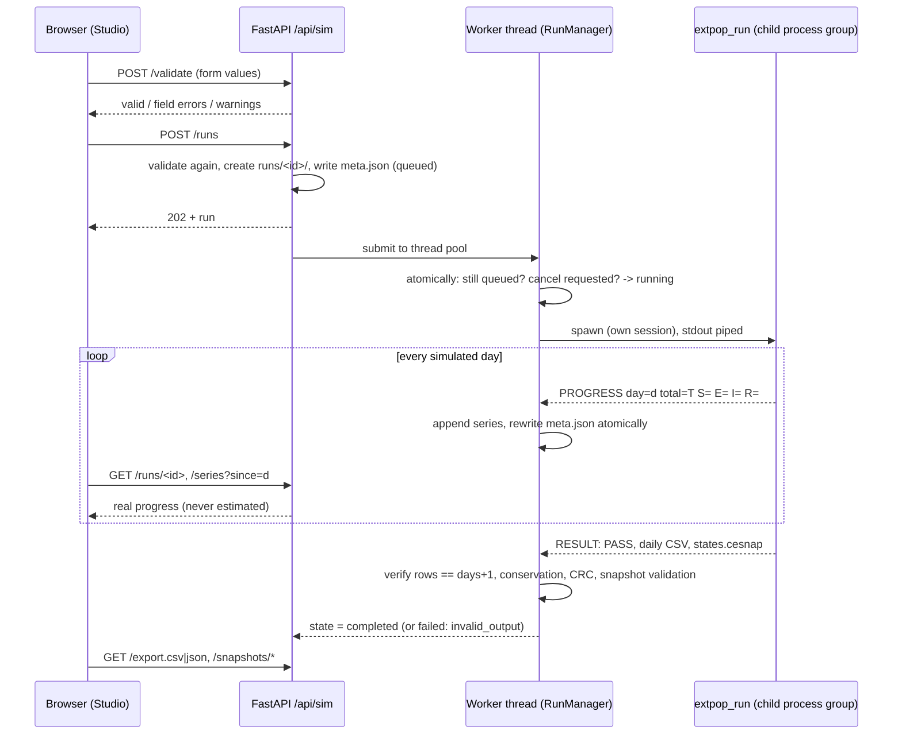
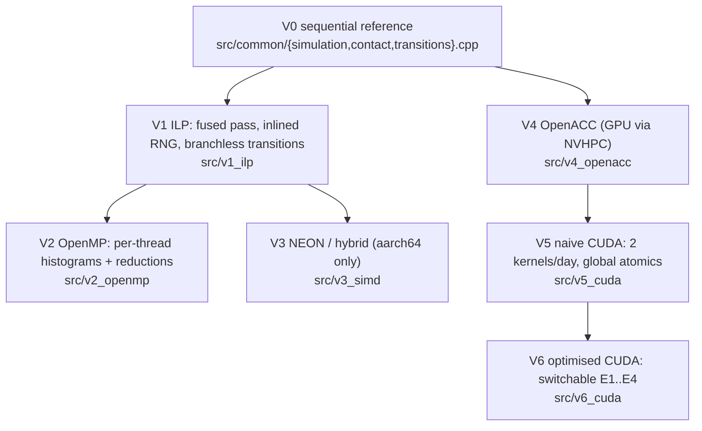
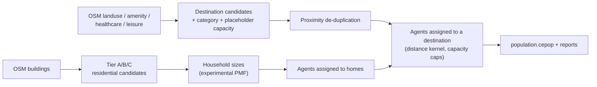

# CityEpi-GPU architecture

Everything here describes code that exists in this repository. Format specifications are in their own documents and are only
summarised: [`cepop_format.md`](cepop_format.md), [`snapshot_format.md`](snapshot_format.md),
[`synthetic_population.md`](synthetic_population.md), [`simulation_api.md`](simulation_api.md),
[`dashboard_pages.md`](dashboard_pages.md).

## 1. System overview

Three separations are deliberate and worth stating in a demo:

1. **Recorded vs live.** The read-only endpoints serve files that were produced earlier (Kaggle runs, benchmark CSVs). Only
   `/api/sim/*` starts a process, and only `extpop_run` (the C++ executable) does the simulation. Nothing is re-implemented in
   Python or in the browser.
2. **Real OSM vs synthetic.** Layers labelled OSM are extracts of OpenStreetMap. Destinations, capacities, household sizes and
   agent assignments are model assumptions (see [`limitations.md`](limitations.md)).
3. **Model vs backend.** All backends implement the same epidemic model; the backends differ only in how the work is executed.

## 2. Simulation execution flow (one live run)

Lifecycle: `queued → running → completed | failed | cancelled`. Cancel and timeout kill the **whole process group** (SIGTERM, then
SIGKILL after a grace period that also covers orphaned group members). On server restart, runs found `queued`/`running` are marked
`failed (interrupted)`. A run is `completed` only after its output passed verification, not merely because the exit code was 0.

## 3. Data flow

| Stage | Input | Output | Code |
|---|---|---|---|
| OSM audit | processed OSM layers | tier counts, tag vocabulary | `scripts/audit_osm_layers.py` |
| Residential candidates | buildings | candidate homes (Tier A/B/C) | `scripts/synthpop/residential.py` |
| Destinations | landuse, amenity, healthcare, leisure | synthetic destinations with placeholder capacities | `scripts/synthpop/destinations.py` |
| De-duplication | destinations | merged set + `dedup_decisions.parquet` | `dedup()` in `scripts/synthpop/destinations.py` |
| Households | config PMF (experimental) | household table | `scripts/synthpop/households.py` |
| Assignment | homes, destinations, capacities | agent → home, destination | `scripts/synthpop/assign.py` |
| Export | all of the above | `agents.parquet`, `locations.geoparquet`, `population.cepop`, `report.json` | `scripts/synthpop/export.py`, `cepop.py` |
| Simulation | `population.cepop` | `daily_v0.csv`, `states.cesnap` | `tools/extpop_run.cpp`, `src/common/external_population.cpp` |
| Serving | bundle + run directories | JSON, CSV, binary frames | `backend/app/*` |
| Presentation | JSON / frames | pages, charts, maps | `frontend/src/*` |

## 4. CPU and GPU backend architecture

All backends share: the Structure-of-Arrays population (`include/agent.hpp`), the parameters (`include/parameters.hpp`), a
**counter-based RNG** whose draw depends only on `(seed, agent, day, slot)` (`include/rng.hpp`, `rng_inline.hpp`, `v4_rng.hpp`,
`v5_rng.hpp`, `v6_rng.hpp`), and a **staged day**: (1) per-location infection probability from the previous day's infectious
tally, (2) per-agent exposure draw + state transition using only start-of-day state, (3) counts and next-day tally. Because no
agent reads another agent's *new* state within a day and the RNG does not depend on thread order, every parallel backend can be
compared **bit-for-bit** with V0.

Not implemented (future ideas only): **V7** multi-scenario GPU execution and **V8** MPI. `ENABLE_MPI` exists as a CMake option (`CMakeLists.txt`), but no
MPI backend source exists in `src/`.

Backend exposure in the live API: **V0 (any host)** and **V6 (only where a usable CUDA executable and GPU are probed)**. V1–V5 are
deliberately not offered by the Studio. Snapshots are **V0 only**.

Backend details with source references: [`pagp_concepts.md`](pagp_concepts.md), [`v4_openacc.md`](v4_openacc.md),
[`v5_cuda.md`](v5_cuda.md), [`v6_cuda.md`](v6_cuda.md).

## 5. Population generation pipeline

Outputs on disk (per dataset): `agents.parquet`, `households.parquet`, `locations.geoparquet`, `population.cepop`,
`report.json|md`, `manifest.json`, `config.json`, `validation_independent.json`. Two populations are recorded: the **legacy**
population (no explicit households; `bengaluru_urban_N100000_seed42`) and the **household-enabled** population
(`..._households_v1`). They also differ in home/destination assignments, so comparing them is not a pure household-effect test.

## 6. CEPOP format (summary)

Binary little-endian container read by `src/common/external_population.cpp` and written by `scripts/synthpop/cepop.py`: a 64-byte
header (magic `"CEPOPv1\0"`, version, endian marker, `n_agents`, `n_locations`, payload CRC-32) followed by six 8-byte-aligned
arrays: `state` (u8, N), `timer` (u16, N), `home_loc` (u32, N), `work_loc` (u32, N), `loc_type` (u8, L; 0 = HOME, 1 = WORK) and
`occupancy` (u32, L; the number of home/work references to each location). The file size is fully determined by (N, L) and any other
size is rejected, as are bad magic/version/flags/reserved bytes, a CRC mismatch and anything `validate_input` refuses. Every
rejection path is unit-tested in `tests/test_extpop_reader.cpp`. The payload CRC-32 is also embedded in CESNAP files so a snapshot
can be tied to its dataset. Geographic metadata is not in the CEPOP file (it is in `locations.geoparquet`, row *i* = location *i*).
Authoritative specification: [`cepop_format.md`](cepop_format.md). The simulator sees only HOME/WORK locations; households live in
the Python-side tables and do not change the simulator.

## 7. CESNAP snapshot format (summary)

`states.cesnap`: 64-byte header, `home_loc` (u32 per agent), **D+1 frames** of 2-bit packed agent states (S=0, E=1, I=2, R=3),
a per-frame S/E/I/R counts table, and a footer with a payload CRC-32. Written to `*.partial` and renamed only when complete.
100,000 agents × 101 frames ≈ 2.8 MiB. The backend validates every snapshot (size, CRC, per-frame counts vs the daily CSV, home
locations vs the CEPOP, CRC equality with the value the executable reported) before a run is marked `completed`; a corrupt snapshot
fails the run and is never exposed. Authoritative specification: [`snapshot_format.md`](snapshot_format.md).

## 8. Dashboard / backend architecture

| Layer | Responsibility | Where |
|---|---|---|
| Recorded-data API | Loads bundle files, caches, serves JSON and geo tiles (bbox/zoom-limited features, density grids, point layers) | `backend/app/main.py`, `geo.py`, `epidemic.py`, `population.py`, `benchmarks.py`, `perf.py` |
| Simulation API | Capabilities probing, validation, run manager, snapshots, exports | `backend/app/sim/{api,registry,models,runs,results,snapshots}.py` |
| Frontend data layer | `useApi` hook, typed client, simulation client, snapshot client | `frontend/src/api/*` |
| Pages | Seven pages, hash-routed (`#overview`, `#gis`, …, `#gpu/<tab>`, `#studio`) | `frontend/src/pages/*` |
| Viewer | Frame store, playback state machine (pure, unit-tested), canvas agent layer on Leaflet | `frontend/src/components/SimulationViewer.tsx`, `lib/viewerCore.ts`, `lib/agentLayer.ts` |

Routing is by URL hash so the app needs no server-side routes. The development server proxies `/api` to the backend
(`CITYEPI_API`, default `http://127.0.0.1:8000`).
